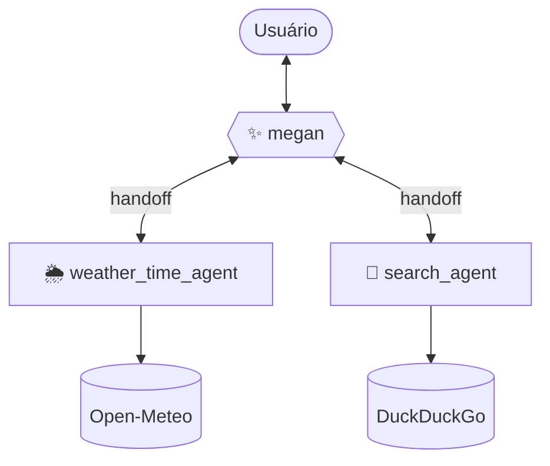

# ✨ Megan

A **Megan** é uma assistente pessoal com inteligência artificial, construída como um sistema **multiagentes**. Ela conversa de forma natural e, quando o pedido exige um conhecimento específico, encaminha a conversa para o especialista certo — que assume o atendimento até o assunto mudar.

Este repositório documenta a **reconstrução da Megan em [LangGraph](https://www.langchain.com/langgraph)**, migrada de uma versão original construída com o [Google ADK (Agent Development Kit)](https://google.github.io/adk-docs/).

---

## 🧠 Arquitetura: um swarm de agentes

A Megan usa o padrão **swarm** (via [`langgraph-swarm`](https://github.com/langchain-ai/langgraph-swarm-py)), e não o padrão supervisor clássico. A diferença importa: no swarm, quando a megan transfere a conversa para um especialista, ele **permanece no comando** — respondendo diretamente às próximas mensagens do usuário — até decidir, por conta própria, que o assunto mudou e devolver a conversa. Isso reproduz o comportamento da versão original em ADK, onde cada especialista "assumia" a conversa em vez de devolver o controle a cada resposta.

Cada agente carrega sua própria ferramenta de transferência (*handoff tool*) para os demais, e decide sozinho, pela própria instrução, quando usá-la.

---

## 👩‍💼 megan — orquestradora

Conversa geral, dúvidas de conhecimento geral, ajuda com textos e ideias. Decide para qual especialista transferir cada pedido, com base na descrição de cada um — e evita inventar informação quando nenhum especialista atende o pedido.

## 🌦️ weather_time_agent — clima e horário

Informa o clima atual, a previsão do tempo (diária e hora a hora, até 16 dias) e a hora local de qualquer cidade do mundo, com dados do [Open-Meteo](https://open-meteo.com/).

## 🔎 search_agent — pesquisa na internet

Pesquisa fatos atuais, notícias, preços e qualquer informação que exija dados recentes da web, via [DuckDuckGo](https://duckduckgo.com/) (`ddgs`). Responde só com base no que a busca retornou, citando a fonte.

---

## 🧩 Camada de modelo

Os modelos são acessados via [LiteLLM](https://www.litellm.ai/) (`langchain-litellm`), com o provedor principal configurável por variável de ambiente (Groq e Gemini testados). Isso mantém a troca de modelo isolada do código dos agentes.

## 💾 Persistência de conversa

Cada conversa é um *thread* no [checkpointer](https://langchain-ai.github.io/langgraph/concepts/persistence/) do LangGraph — o equivalente ao `DatabaseSessionService` do ADK. Localmente, usa SQLite (`AsyncSqliteSaver`); em produção, Postgres (`AsyncPostgresSaver`), escolhido automaticamente a partir da mesma variável `DATABASE_URL`.

## 🧪 Ambiente de testes

O desenvolvimento é validado localmente com o [LangGraph Studio](https://langchain-ai.github.io/langgraph/concepts/langgraph_studio/), servido por `langgraph dev`: uma UI que permite conversar com qualquer um dos agentes, inspecionar a troca de mensagens entre eles e acompanhar as transferências (*handoffs*) em tempo real — o equivalente ao `adk web` da versão original.

---

## 🧰 Tecnologias

| Camada | Tecnologia |
|---|---|
| Orquestração de agentes | [LangGraph](https://www.langchain.com/langgraph) + [`langgraph-swarm`](https://github.com/langchain-ai/langgraph-swarm-py) |
| Modelos | Groq / Gemini (configurável), via [LiteLLM](https://www.litellm.ai/) |
| Persistência | SQLite (dev) / PostgreSQL (produção), via checkpointers do LangGraph |
| Clima e horário | [Open-Meteo](https://open-meteo.com/) |
| Pesquisa na web | [DuckDuckGo](https://duckduckgo.com/) (`ddgs`) |
| Ambiente de desenvolvimento | [LangGraph Studio](https://langchain-ai.github.io/langgraph/concepts/langgraph_studio/) |

---

## 🚧 Status da migração

Esta é uma reconstrução em andamento, migrando progressivamente da versão original em Google ADK. Já migrado: a orquestração (megan), o clima/horário e a pesquisa na web. Ainda não migrados: integração com WhatsApp, finanças, lista de compras, agenda do Google, login por código e respostas em voz.

Projeto pessoal de estudo de agentes de IA.

